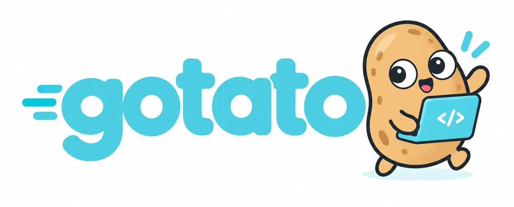

<div align="center">




🎯 **Our mission: Agent-as-a-Service.** Ultimately, any service can easily become an agent. The agent becomes the cloud service itself.

[](https://github.com/jinhuang712/gotato/actions/workflows/ci.yml)
[](https://pkg.go.dev/github.com/jinhuang712/gotato)
[](LICENSE)


</div>

## 🤔 Why

Four things get in the way when a Go service needs an agent:

- 🐍 **Not Go.** A Python, TypeScript or Rust stack means a second language, build and deployment. The agent becomes a system *beside* your service.
- 🕸️ **Too heavy.** Graph frameworks are slow, costly and hard to debug. One loop does the job: call the model, run its tools, repeat.
- 🧠 **Lost on every deploy.** Agent stacks keep the conversation in one process's memory. A rolling deploy or a scale-down ends it, and pinning each chat to a pod gives up what scaling is for.
- 🏋️ **A machine per chat.** Anthropic's hosting guide starts each Agent SDK session at 1 GiB RAM and 1 CPU, paid while the conversation sits idle.

## 💡 The idea

An **Agent** is a definition: model, instruction, tools, limits. A **Session** is one conversation running it: a small loop, plus a runtime that saves every step to your store.

Between messages a Session is only a record in your store. Any pod can load it and carry on, and one writer per Session keeps two pods apart. No process, no shell, no sandbox, and a few kilobytes while idle.

A request can reach any pod. Only one of them runs a given Session at a time, and the Session itself lives in your store:

```text
                request
                   │
      ┌────────────▼────────────┐
      │      load balancer      │   the one you already run
      └───┬───────────┬───────┬─┘
          │           │       │
      ┌───▼───┐   ┌───▼───┐ ┌─▼─────┐
      │ pod A │   │ pod B │ │ pod C │   each pod: a Runner hosting Sessions
      └───┬───┘   └───┬───┘ └─┬─────┘
          └───────────┼───────┘
      ┌───────────────▼─────────────┐
      │         your store          │   Session S = its record, a log that only grows
      └─────────────────────────────┘

  pod A runs S ──► pod A goes away ──► the next message reaches pod B, which loads S and goes on
```

[PROPOSAL.md](PROPOSAL.md) tells the longer story.

## ✨ What you get

| | |
|---|---|
| 🔌 **Fits your service** | A library, not a new stack: `go get`, and it builds and deploys with your service. The core uses only the standard library. Your store, your telemetry, any model provider. |
| 🌐 **Runs on many pods** | Every step is saved as it happens, so no conversation is lost. Any pod answers as if it were the only one, and only one pod runs a Session at a time. |
| 🧩 **Stays simple** | One loop, no workflow language. You can inspect exactly what the model sees. Tools declare their effect, so they are safe without a sandbox. |
| 🔒 **Stays stable** | The Go API, the HTTP and gRPC contracts and the saved Session change only through versioned breaks, with before-and-after notes. From the first release on. |

📏 A program that imports the agent, the runner, the session store and the HTTP server pulls 3 modules and builds a 3.8 MB binary on Go 1.22 (measured 2026-10-15; [the numbers](PROPOSAL.md#where-gotato-fits)).

## 🚫 What it is not

Not a cloud coding agent, a remote dev environment, a general-purpose assistant, a workflow language, an approval system, a separate platform, infrastructure, or a set of ready-made clients. [Why not](PROPOSAL.md#what-we-dont-want).

## ⚡ How Simple is Gotato?

```go
import (
    gotato "github.com/jinhuang712/gotato/gotato-core"
    "github.com/jinhuang712/gotato/testkit"
)

s, err := gotato.NewSession(
    gotato.WithModel(testkit.EchoModel{}), // any gotato.Model; providers live in gateway/
    gotato.WithInstruction("You are a helpful assistant."),
)
if err != nil {
    return err
}
defer s.Close(ctx)

result, err := s.Prompt(ctx, gotato.UserMessage("hello"))
fmt.Println(gotato.TextOf(*result.FinalMessage)) // echo: hello
```

> [!TIP]
> No provider key is needed to try this: `testkit.EchoModel` answers `echo: <your text>`.

`Prompt` returns when the Run settles, and `ctx` carries its cancellation and deadline. This code is run as a test: [example_test.go](gotato-core/example_test.go).

## 📦 What you import

The core, `gotato-core`, is the package every program uses. It depends on the standard library alone, and it is complete on its own: a Session with an in-memory conversation, tools, and Events. The other packages add what a service needs.

| You want to | Import |
|---|---|
| Run an agent in your program | `gotato-core`, and a model: `gateway` for OpenAI or Anthropic, or your own `gotato.Model` |
| Keep conversations in a store and continue them on any pod | add `service` (the Runner) and `session` (the Store) |
| Keep long conversations small | `modelctx`; the Runner brings it |
| Call MCP servers, or read large results with a `bash` tool | `adapter/mcp`, `adapter/bash` (modules of their own) |
| Serve it over HTTP or gRPC | `service/httpapi`, `adapter/grpc` |
| Write tests with a fake model | `testkit` |
| See an application on many pods | the chat bot in `examples/larkbot` ([guide](guides/example-chat-bot.md)) |

Without `session` a conversation lives in the memory of one process and is gone when it exits; that is the one thing to add before you run on many pods.

Guides: [Install](guides/install.md), [Getting started](guides/getting-started.md) and [Embed Gotato in a service](guides/embed-in-a-service.md); [Example: a chat bot](guides/example-chat-bot.md) runs several instances locally. Each feature, with its status, is in [FEATURES.md](FEATURES.md).

## 🚀 Install

> [!WARNING]
> Gotato has no release yet. A version is a commit, and until the first release a name may change.

Pin a commit you have tested:

```sh
go get github.com/jinhuang712/gotato@<commit>
```

[Install](guides/install.md) has the details, including the adapters.

## 📚 Documents

| Document | Role |
|---|---|
| [PROPOSAL.md](PROPOSAL.md) | why Gotato exists, and what it refuses to become |
| [PHILOSOPHY.md](PHILOSOPHY.md) | the beliefs behind it |
| [DESIGNS.md](DESIGNS.md) | design principles, and the decisions that follow from them |
| [GLOSSARY.md](GLOSSARY.md) | one name per thing, and its name in today's code |
| [FEATURES.md](FEATURES.md) | what is built, with status markers, and what is not planned |
| [RUNBOOK.md](RUNBOOK.md) | what to do when a service built on Gotato misbehaves |
| [plan/GOALS.md](plan/GOALS.md) | goals that pass or fail, and benchmarks tracked against a reference |
| [plan/ROADMAP.md](plan/ROADMAP.md) | what gets built next, and how each step is known to be done |
| [plan/TODO.md](plan/TODO.md) | open defects and decisions |
| [AGENTS.md](AGENTS.md) | how to work in this repository, and the Git policy |
| [CHANGELOG.md](CHANGELOG.md) | what changed, newest first |

## 📄 License

Gotato is licensed under the [Apache License 2.0](LICENSE).
