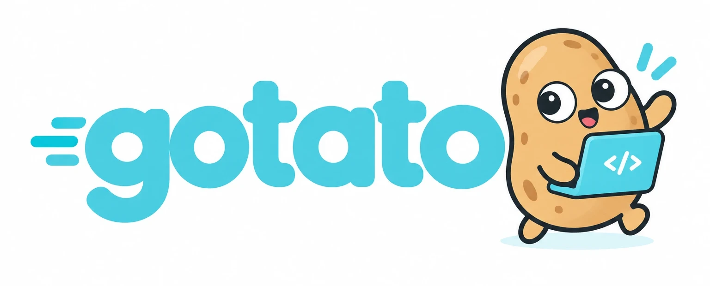

<div align="center">




🎯 **Our mission: Agent-as-a-Service.** Ultimately, any service can easily become an agent. The agent becomes the cloud service itself.

[](https://github.com/jinhuang712/gotato/actions/workflows/ci.yml)
[](https://pkg.go.dev/github.com/jinhuang712/gotato)
[](LICENSE)


</div>

Gotato is a Go library that runs agents inside your own service, on many copies of it at once. What sets it apart is one constraint: a conversation lives in your store and not in any process. Every step is saved as it happens, so any copy of your service can load the conversation and carry on, and a killed or replaced pod ends nothing. A Session is a small loop over a log, a few kilobytes while it idles, with no process, no shell and no sandbox.

An **Agent** is a definition: model, instruction, tools, limits. A **Session** is one conversation running it. Only one pod writes a Session at a time, claimed in the store, and a request may reach any pod. The core needs only the standard library, so the agent is a package of your service and not a system beside it.

## What it does

- 🔁 **One loop:** `Prompt`, `Continue` and `Abort`, and steer, follow up or interrupt a Run in flight.
- 🧠 **A bounded context:** built fresh every Turn and laid out for the provider's prompt cache. Long Sessions compact into Segments the model can read back.
- 🛠️ **Tools:** Go functions with an Effect that caps what an Agent may do. Tool search, MCP tool sets and paged results come with them.
- 🔌 **Models:** three wire APIs ship and a fourth is one type of your own, in four layers a team can replace.
- 🗄️ **Your store:** memory, files, or your database behind a small contract with a conformance suite.
- 🌐 **Many pods:** one writer per Session, with takeover when a pod dies and a drain on shutdown. A message that misses the writer is told where to go.
- 📡 **Events:** every step is a Go type, written before it is sent and resumable on any pod.
- 🧪 **Testing:** fake models and tools, a fake endpoint for each wire API and a reference workload.

Gotato is not a coding agent, a workflow language, a platform or infrastructure. It runs purpose-built agents inside your service, and your service owns routing, credentials, databases and screens. A program with the agent, runner, store and HTTP server links a small fraction of the modules and packages that Google ADK for Go needs, into a smaller binary; GOALS.md keeps the measurement and its date.

## Install

```sh
go get github.com/jinhuang712/gotato@v0.2.0
```

The MCP adapter and the HTTP adapter are modules of their own, so a service that uses neither carries none of them. [guides/install.md](guides/install.md) has their commands and the Go version each needs, and says what was never checked against a real provider.

## How to use

The first task is one agent with one tool, answering a question.

1. Build a model with `model.New`: a wire API, a connection with an endpoint and a key, and a `gotato.ModelConfig` that names the model and states its window. For a first run, `testkit.EchoModel` needs no key.
2. Write a tool as a Go function with `gotato.NewFuncTool`. Its input type becomes the schema the model sees.
3. Open a Session with `gotato.NewSession`, giving it the model, an instruction and the tool.
4. Call `Prompt` with a user message. It runs the loop, asking the model, running the tool it calls and asking again, and returns when the Run settles with the final reply.

To run on many pods, build a `host.Runner` over a Store with an AgentProfile registered, and give each request a Session ID. [Getting started](guides/getting-started.md) walks through the first task with code that runs as a test, and [Embed Gotato in a service](guides/embed-in-a-service.md) goes on to pods. The chat bot in `examples/larkbot` runs on your machine with a fake chat platform and no secrets, and on a local cluster through a rolling deploy, a killed writer and a scale-down.

## Architecture

A request reaches any Instance, which is one copy of your service. The Instances never talk to each other: they meet only in your Store, and each layer imports only the layers below it.

```text
 callers ──▶ your load balancer ──▶ Instance A │ Instance B │ Instance C     no arrows between Instances
                                          │
 inside one Instance (a layer imports only the layers below it)

   adapter/http   routes over the Runner                      ┐ beside the layers, import down:
   host           the Runner: admit, claim, warm, drain       │   model        calls a model over HTTP ──▶ model providers
   profile        AgentProfiles, TaskSpecs, the Registry      │   adapter/mcp  tool servers ──▶ MCP servers
   store          the Store contract, the Writer, two stores  │   testkit      fakes for tests
   record         the Record, compaction, read-back           ┘
   gotato         the Session, the Loop, Model, Tool, Event
   ref            the form of a reference
                                          │ Records, Liveness rows, Definitions
                                          ▼
                 your Store: a database, files, or memory for tests
```

## Docs

Start with the proposal to see why Gotato exists, and with the architecture to see how it fits together.

| Doc | Answers |
|---|---|
| [PROPOSAL.md](PROPOSAL.md) | why Gotato exists, and what it refuses to become |
| [PHILOSOPHY.md](PHILOSOPHY.md) | the beliefs behind it |
| [DESIGNS.md](DESIGNS.md) | the guidelines every change must satisfy |
| [plan/GOALS.md](plan/GOALS.md) | what is checked, and when |
| [FEATURES.md](FEATURES.md) | what it does, and what it will do |
| [plan/ROADMAP.md](plan/ROADMAP.md) | when, and how far along |
| [plan/TODO.md](plan/TODO.md) | open defects and decisions |
| [GLOSSARY.md](GLOSSARY.md) | one name per thing, and its name in code |
| [specs/ARCHITECTURE.md](specs/ARCHITECTURE.md) | how the parts fit together |
| [specs/session.md](specs/session.md) | the Session, the Run and its ending |
| [specs/events.md](specs/events.md) | Events: written, numbered, streamed, resumed |
| [specs/context.md](specs/context.md) | what the model sees each Turn |
| [specs/compaction.md](specs/compaction.md) | closing old history into Segments |
| [specs/record.md](specs/record.md) | the Record: facts, log, forks, spilled results |
| [specs/store.md](specs/store.md) | the Store contract, the Writer, the shipped stores |
| [specs/profile.md](specs/profile.md) | AgentProfiles, TaskSpecs and the Registry |
| [specs/host.md](specs/host.md) | the host: Claims, takeover, warm copies, drain |
| [specs/tools.md](specs/tools.md) | Effects, tool search, calls, MCP, large results |
| [specs/model.md](specs/model.md) | the model bridge, its four layers and retries |
| [specs/errors.md](specs/errors.md) | what ran, and whether to retry |
| [specs/http.md](specs/http.md) | the HTTP API: routes, errors as statuses, streaming and resuming |
| [specs/mcp.md](specs/mcp.md) | an MCP server's tools as a tool set |
| [specs/testing.md](specs/testing.md) | fakes at three levels, the reference workload, faults on purpose |
| [plan/decisions/README.md](plan/decisions/README.md) | the choices made, with the ways not taken |
| [RUNBOOK.md](RUNBOOK.md) | keeping a service built on Gotato running |
| [CONTRIBUTING.md](CONTRIBUTING.md) | changing Gotato itself, the checks, and cutting a release |
| [guides/install.md](guides/install.md) | adding Gotato to your `go.mod` |
| [guides/packages.md](guides/packages.md) | which packages to import, and what leaving one out costs |
| [guides/getting-started.md](guides/getting-started.md) | a Session, a tool and the Events of a Run |
| [guides/embed-in-a-service.md](guides/embed-in-a-service.md) | the Runner, many pods and shutting down |
| [guides/http-in-five-minutes.md](guides/http-in-five-minutes.md) | a service you can `curl` |
| [guides/minimal-main.md](guides/minimal-main.md) | a complete program, and the order to shut it down in |
| [guides/write-a-tool-and-model.md](guides/write-a-tool-and-model.md) | a Tool, a ToolSet and a Model wrapper |
| [guides/write-a-store.md](guides/write-a-store.md) | the Store contract and the suite that checks an adapter |
| [guides/test-with-fakes.md](guides/test-with-fakes.md) | scripted models and tools, no network |
| [guides/extension-points.md](guides/extension-points.md) | which seam changes what |
| [guides/example-chat-bot.md](guides/example-chat-bot.md) | several instances behind a chat platform |
| [examples/larkbot/README.md](examples/larkbot/README.md) | a Lark chat bot on several instances, and a local cluster to try it on |
| [bench/refservice/README.md](bench/refservice/README.md) | the reference service that GOALS measures |
| [internal/cmd/gotato/README.md](internal/cmd/gotato/README.md) | the maintainers' test tool |
| [skills/gotato/SKILL.md](skills/gotato/SKILL.md) | a skill that helps a coding agent add Gotato to a Go project |
| [AGENTS.md](AGENTS.md) | how to work in this repository |
| [CHANGELOG.md](CHANGELOG.md) | what changed, newest first |

## License

Gotato is licensed under the [Apache License 2.0](LICENSE).
